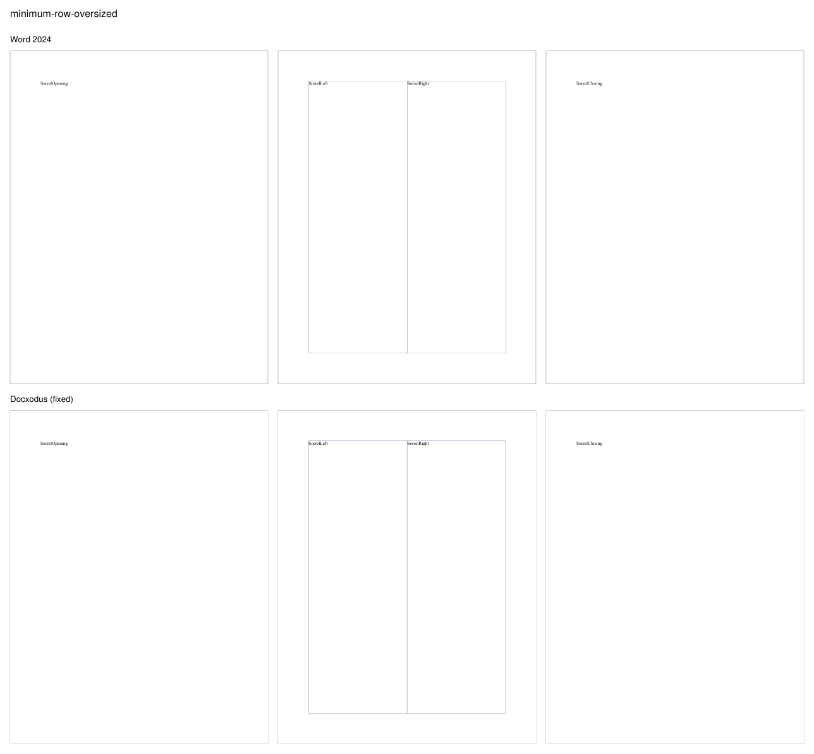
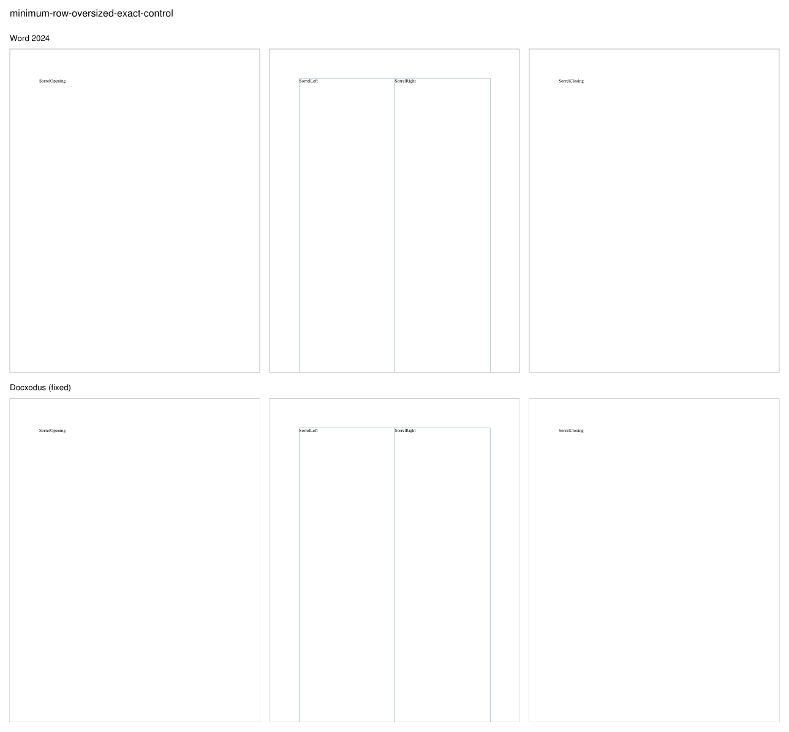
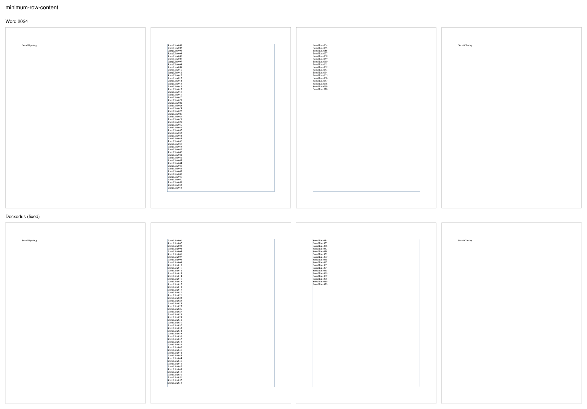
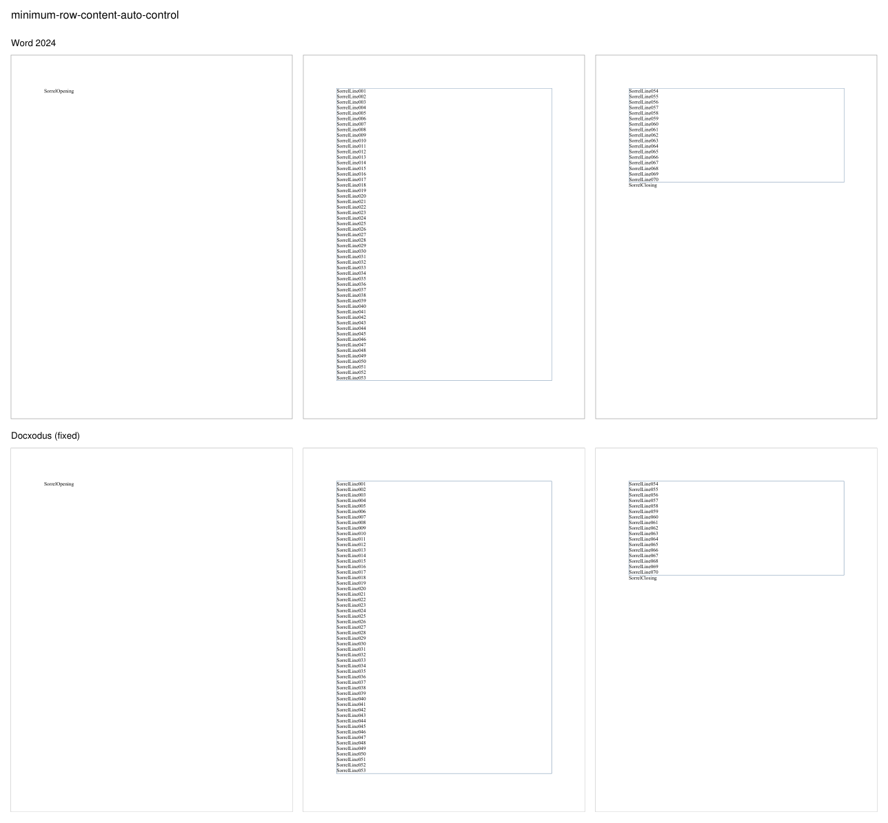
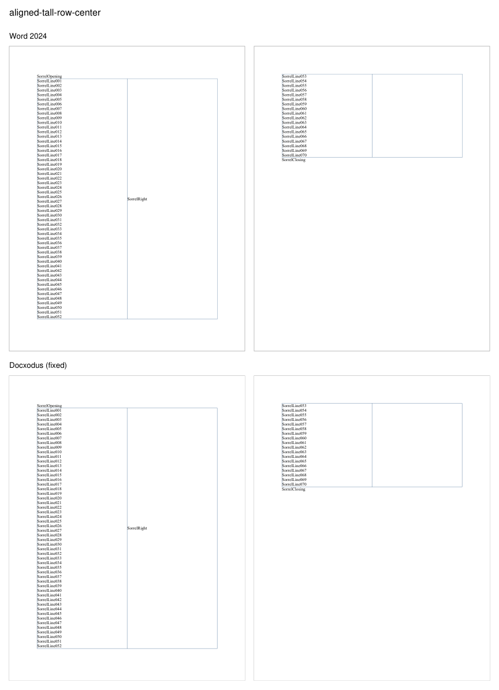
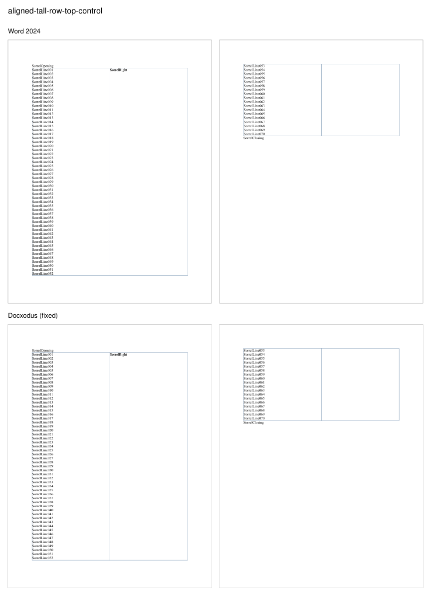

# Tall table rows (Docxodus #1558)

Six original Sorrel cases: three reproducers, each with a control that differs by one property.
Letter paper, 1in margins (body 72pt to 720pt), 11pt Liberation Serif on exact 12pt lines.

| Case | One difference | Word 2024 |
|---|---|---|
| `minimum-row-oversized` | 16000-twip `w:trHeight`, minimum | the row moves to page 2 and ends at the body foot; SorrelClosing starts page 3 |
| `minimum-row-oversized-exact-control` | `w:hRule="exact"` | the row moves to page 2 and runs past the paper edge; SorrelClosing starts page 3 |
| `minimum-row-content` | 15000-twip minimum on a `w:cantSplit` row holding 70 lines | lines continue from page 2 to page 3; the page-3 part fills the page, so SorrelClosing starts page 4 |
| `minimum-row-content-auto-control` | no `w:trHeight` | SorrelClosing follows SorrelLine070 on page 3 |
| `aligned-tall-row-center` | both cells `w:vAlign="center"` | the row splits after SorrelOpening; SorrelRight is centered in the page-1 part |
| `aligned-tall-row-top-control` | `w:vAlign="top"` | SorrelRight at the top of the page-1 part |

The `marker-region` assertions are Word-adjudicated: page and box of each marker in Word 2024's
own PDF of the same input with Liberation Serif replaced by its metric twin Times New Roman.
LibreOffice references are pending.

Docxodus main before the fixes failed `minimum-row-oversized`, `minimum-row-content` and
`aligned-tall-row-center` with `Page N body content is clipped`. With JSv4/Docxodus#1661 and
JSv4/Docxodus#1664 all six export with Word's page placement. One known difference remains:
Docxodus breaks the 70-line row after SorrelLine053 where Word breaks after SorrelLine054 (an
exact fit of the band), with or without a minimum height; the assertions do not pin that line.

Labeled renders, Word 2024 above and Docxodus with the fixes below:

