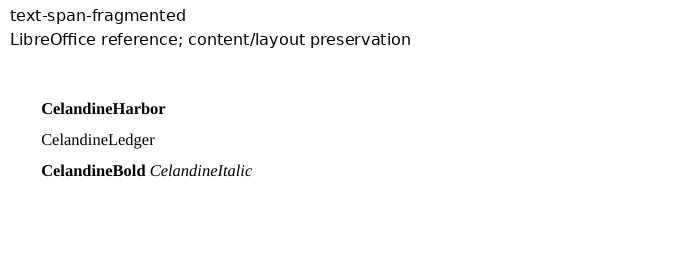
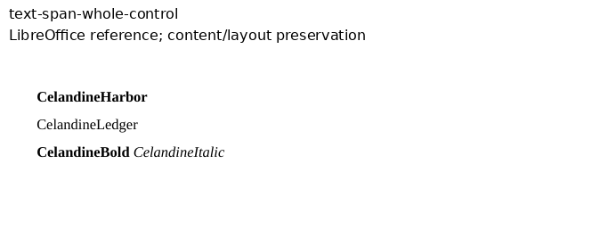

# Adjacent text spans

The two original Celandine inputs accompany [Docxodus #1624](https://github.com/JSv4/Docxodus/issues/1624).
The fragmented input splits one bold word between identically styled runs and one ordinary
word at a complex-script-only property. The whole-run control writes each word in one run.
Both include separate bold and italic words that must retain their formatting.

The complete token inventories and marker positions check PDF content and layout preservation.
They do not detect HTML span splitting: that contract is tested through the public main-thread
and worker conversion APIs in Docxodus. No Word observation or candidate fidelity score is claimed.

Both source-bound LibreOffice captures are eligible under the declared font/content contract.
The [capture bundle](reference-bundle.json) records the input and PDF hashes, environment,
font contract, inspections and capture provenance. The screenshots show the complete authored
content, cropped to the top of each single page. Candidate rendering and full-suite scoring
remain pending. All prior DOCX input hashes are unchanged.

