# Effective textbox fit at the paper edge

Twelve original Linden fixtures cover omitted fit, explicit fixed fit, text/line/shape theme
defaults, an empty theme, local precedence, headers and footers. Three on-page controls cover
default, growing and shrinking fit. All packages validate with Open XML SDK 3.5.1. `core-v92`
contains 645 cases; the preceding 633 inputs and contracts are unchanged except the generator hash.

The edge cases use a box at x=84pt, y=748pt with a 180pt by 96pt extent. Three labeled lines
remain on Letter paper, while an empty deleted paragraph's markup is wholly off paper. The two
explicit-fixed controls retain that exact content and placement. The three on-page controls
use y=60pt and an ordinary empty paragraph: LibreOffice omits a deleted paragraph's generated
mark even in markup output, whereas Docxodus displays it. No token exception is added for that
renderer difference. Public renderer tests separately retain on-page tracked-mark coverage.

| Cases | Main | Fixed | LibreOffice 25.8.7.3 |
| --- | --- | --- | --- |
| Omitted local fit; absent, empty, text, line or shape defaults | Five refusals | Complete | Complete |
| Header default and footer text default | Two refusals | Complete | Complete |
| Explicit fixed and local-over-theme controls | Complete | Identical page rasters | Complete |
| Three on-page controls | Complete | Identical page rasters | Complete |

Main is `72319002a6286d09d68eb5b555434f35fc435945`, captured with the identical source tree
and runtime from `0875eab87ecaf0af716af7c585f9745d159c4a95`. The fixed source is
`8ba4e1121698309483f03dab983aa0c50a3aa843`. All twelve candidate PDFs pass complete token
inventories, declared-font checks, physical geometry and visible-label bounds. All twelve native
references are eligible. All five control page PNGs are byte-identical between main and fixed.

These local diagnostics use strict fonts, explicit Liberation Serif files and caller-owned,
sandboxed Chromium 143.0.7499.4; reports identify the runtime as `browserObserved`.
Production owned-process measurements are recorded below. This demonstrates completeness and correct
refusal behavior, not exact native layout parity. No fresh Word reference is claimed.

[Input, PDF, report, runtime and screenshot bindings](local-evidence.json) record every check.
[SDK validation](source-sdk-validation.json) binds each package hash to its findings. Every
sheet shows all actual PDF pages at 96 DPI and 100%, without cropping or resampling. There are
29 actual page panels and seven explicitly labeled export refusals.

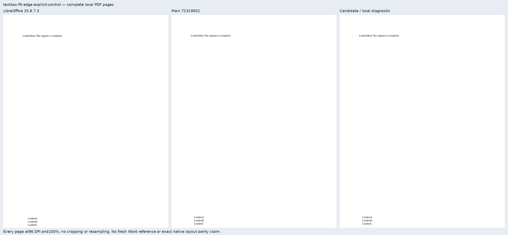

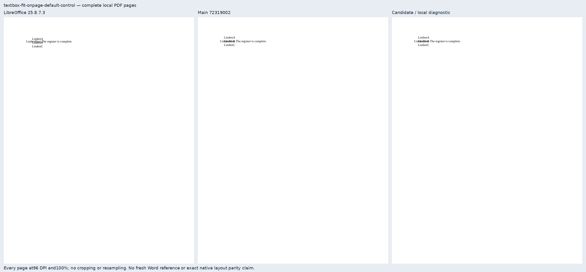

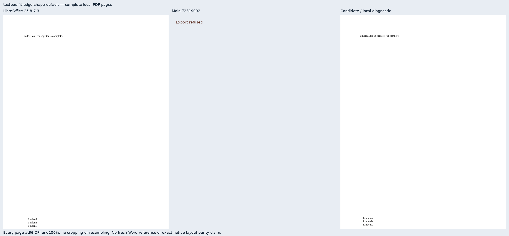

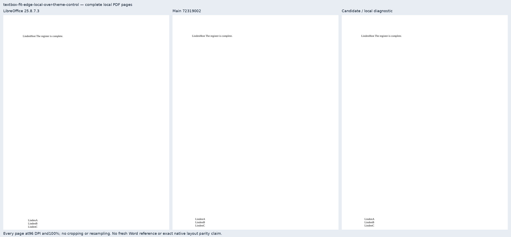

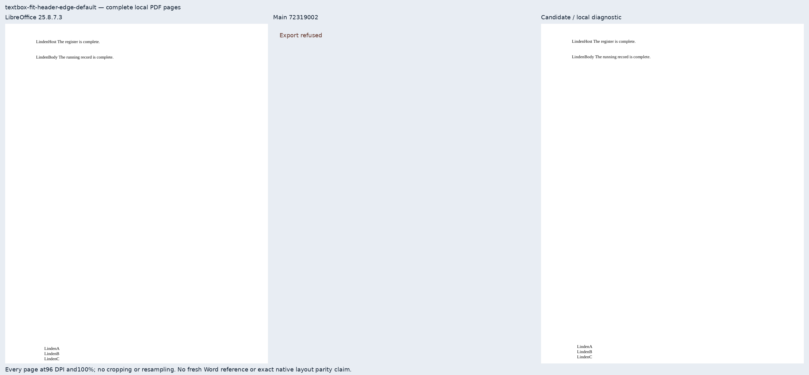

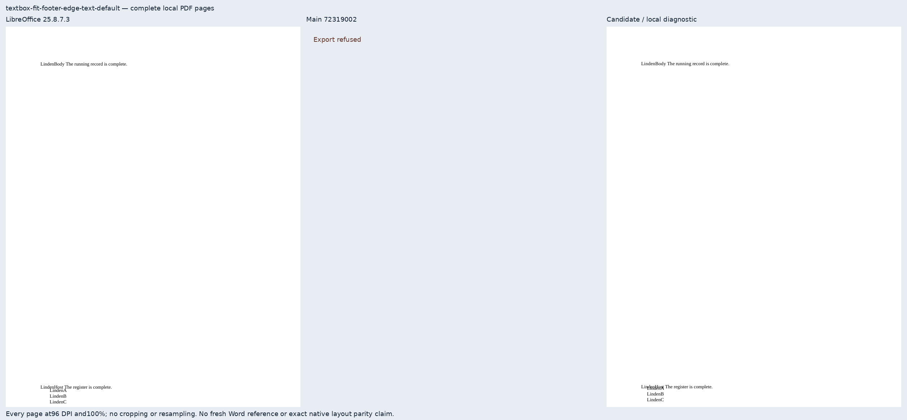

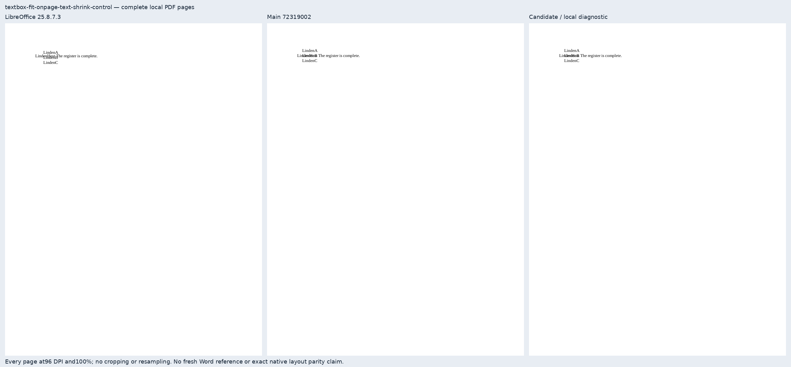

## Production validation

[Candidate run 41226336896](https://github.com/JSv4/docx-fidelity-bench/actions/runs/41226336896)
and [main run 41224613858](https://github.com/JSv4/docx-fidelity-bench/actions/runs/41224613858)
built exact renderer commits `8ba4e1121698309483f03dab983aa0c50a3aa843` and
`72319002a6286d09d68eb5b555434f35fc435945` at frozen benchmark commit
`bc00aab10f62f4fcacc654edf6b3c775a56314d8`.

All twelve candidate PDFs pass every mandatory check; main passes the five controls and
refuses seven cases. Both reference calibrations score 100. All five control page-PNG sets
and scores are unchanged. The raw layout score is 72.85240905712722 for the candidate and
29.86269440262099 for main. No case meets the close-match threshold: text positions still
differ from LibreOffice, and completeness does not establish exact native layout parity.

[Production artifact, runtime, PDF and screenshot bindings](production-evidence.json) retain
both original ZIP hashes and all per-case checks and measurements. These twelve production
sheets show 29 actual artifact pages and seven labeled refusals, at 96 DPI and 100% without
cropping or resampling. All twelve references are eligible; no case is excluded from scoring.
The earlier candidate run 41224611747 is superseded and is not used for these results.

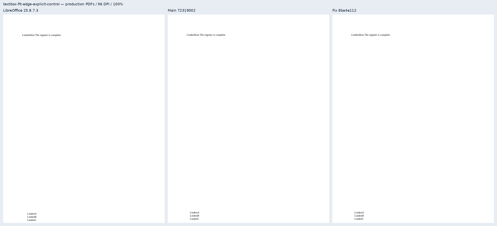

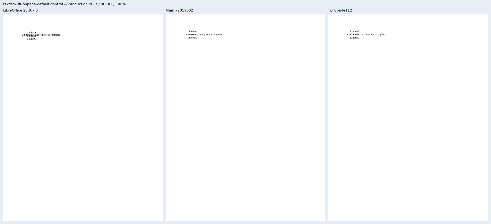

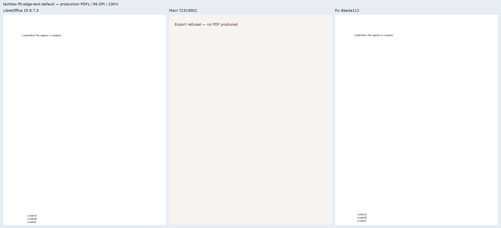

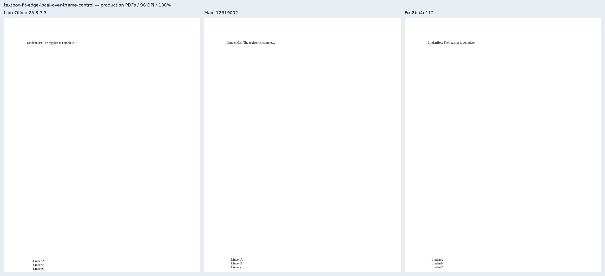

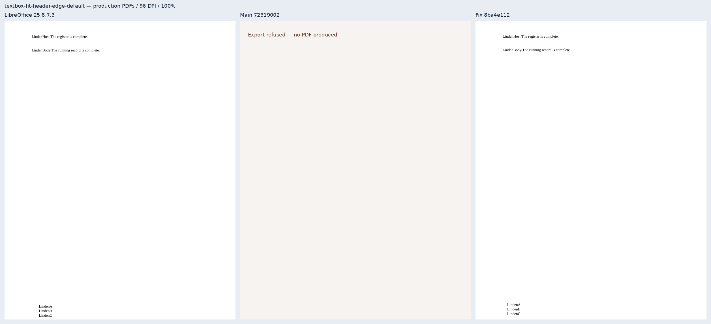

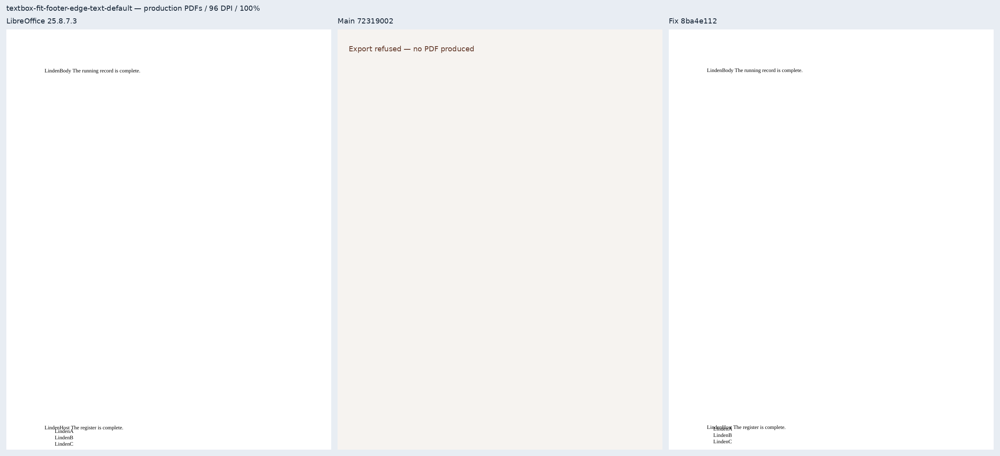

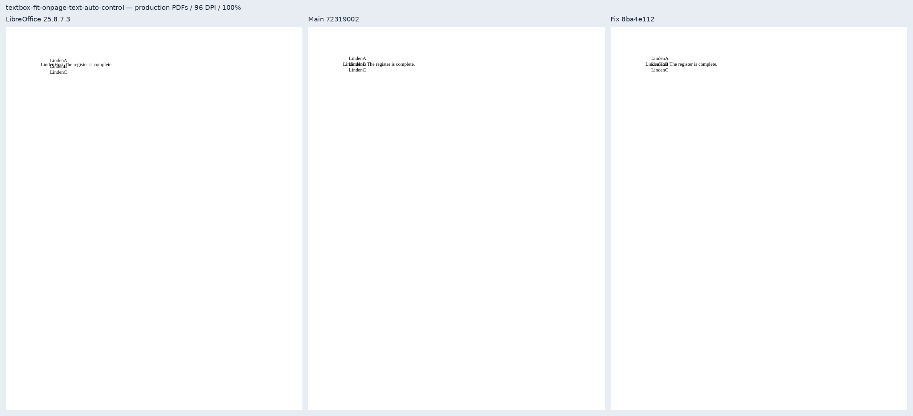

