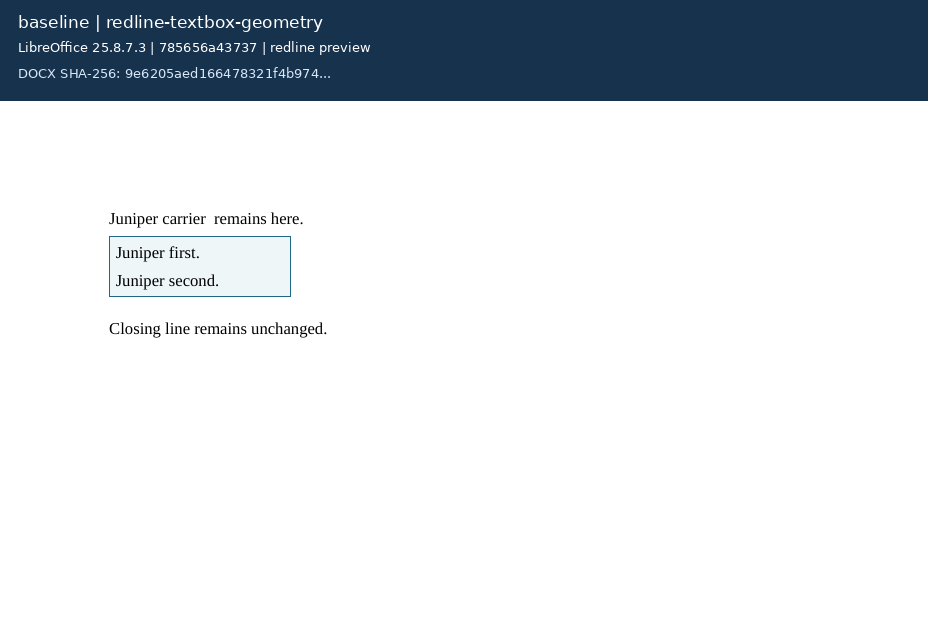
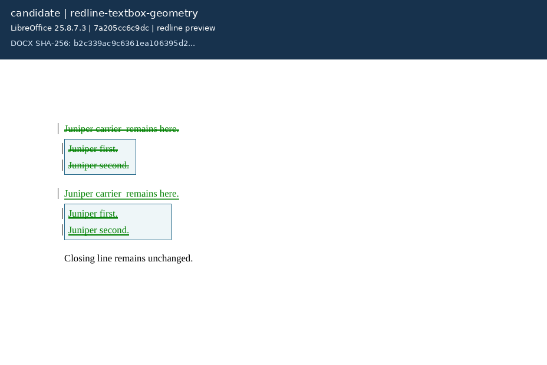
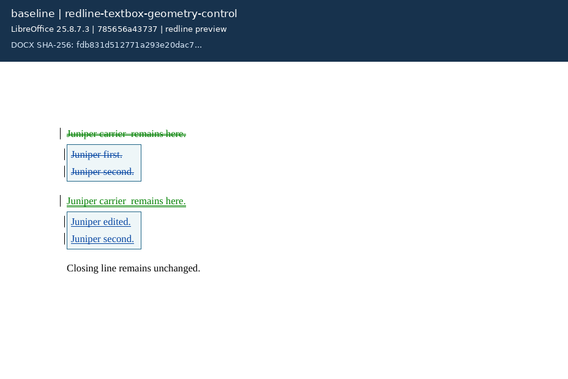
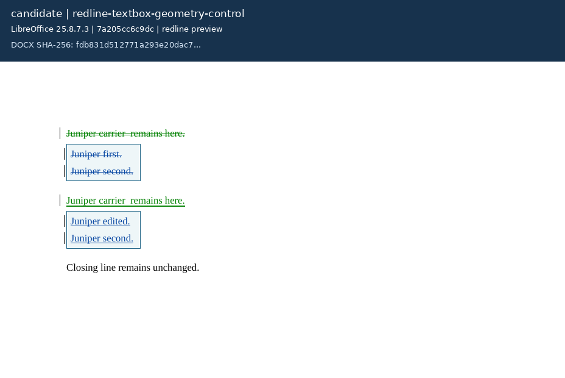

# Pure textbox carrier geometry

Independent original Juniper cases for [Docxodus #1425](https://github.com/JSv4/Docxodus/issues/1425). Two VML textboxes share one `w:pict`. The reproducer changes only the first width from 80pt to 120pt. The control changes only its text, keeping geometry fixed. Outlines and paragraph spacing make both alternatives visible in the review previews.

Baseline `785656a43737ba954fcab9319c3db03a50bc10a9` fails the geometry reproducer and passes the control. Candidate `7a205cc6c9dc1d0186042b7152f1ace53aa951fa` and the independently authored calibration pass both. These are focused diagnostics for 2 of 210 cases in `redline-v23`; no full-suite score is reported.

| Case | Main | Candidate | Authored calibration |
| --- | ---: | ---: | ---: |
| redline-textbox-geometry | 0 | 100 | 100 |
| redline-textbox-geometry-control | 100 | 100 | 100 |

The independent markup resolver checks accepted/rejected views. Metric contract 14 extends the existing exact subtree observer to `w:pict`, checking both shapes, all geometry attributes, and both textbox bodies. A text-only match is insufficient here. Mutation tests reject old widths and missing body text; copying either input also fails the complete checks. The six original input/authored packages have zero Open XML SDK findings, and candidate outputs pass the no-new-errors gate. All 208 previous cases and package bytes remain unchanged.

[Evidence](evidence.json) records full source/build identities, metric and environment contracts, output digests, and each mandatory check outcome. [Capture records](captures.json) bind every labeled screenshot to its redline DOCX, LibreOffice-exported PDF, and PNG. Screenshots use LibreOffice 25.8.7.3 and first-page Poppler rasterization, with blank lower-page cropping and an added review label. They are redline previews, not Word references or PDF fidelity scores.

LibreOffice retains an extra empty paragraph after accepting or rejecting both independently authored whole-paragraph redlines. These four measured calibration failures are explicitly ineligible. Independent markup, exact geometry/body checks, and SDK validation remain mandatory. No Word behavior is inferred.

## Reproduce

Build the standard adapter against a clean checkout at either full commit above, then run:

```sh
python3 -m bench redline build-docxodus --source /path/to/Docxodus --commit FULL_COMMIT --out runs/textbox-build
python3 -m bench redline build-validator --out runs/validator
python3 -m bench redline run --adapter docxodus --candidate FULL_COMMIT \
  --build runs/textbox-build --validator runs/validator --out runs/textbox-result \
  --case redline-textbox-geometry --case redline-textbox-geometry-control
```

Use `--adapter authored --candidate authored-calibration` without `--build` for calibration. The adapter checks source and binary identity before every case. Baseline scoring fails the exact rejected carrier width; candidate and calibration score 100 on each focused case.

## Previews

### redline-textbox-geometry





### redline-textbox-geometry-control




