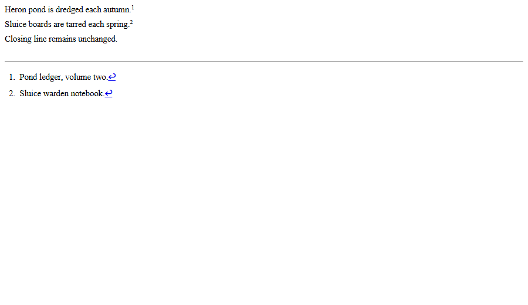
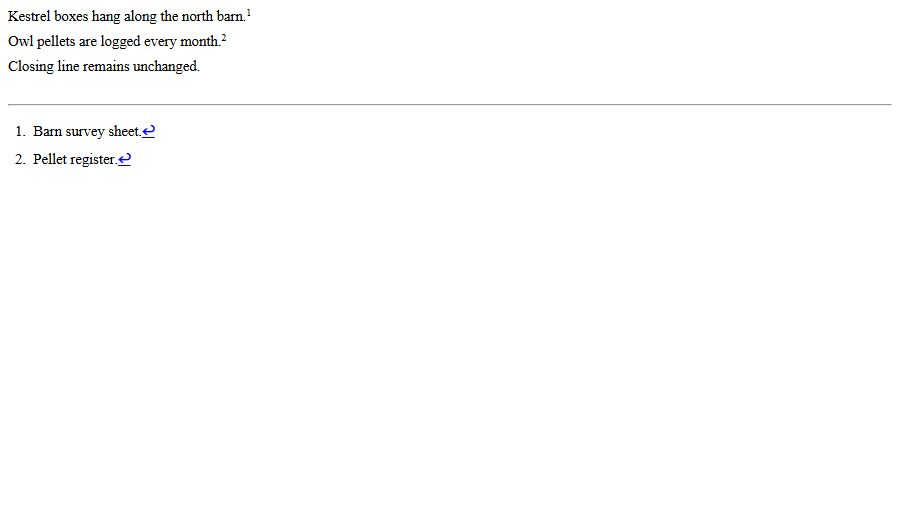
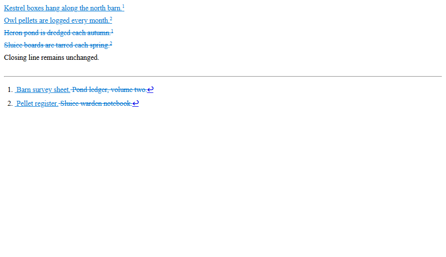
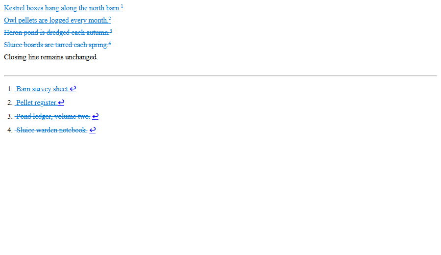
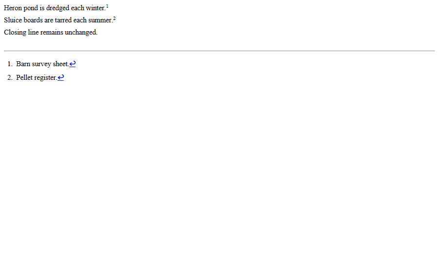
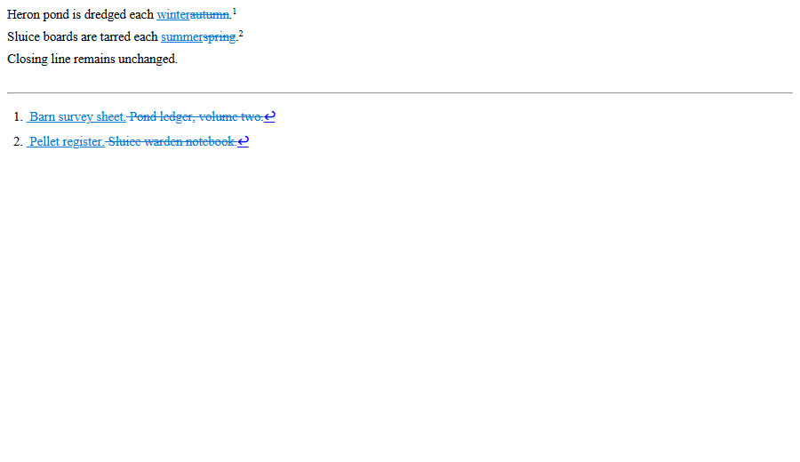

# Notes whose citations the comparison does not keep (Docxodus #1701)

Every image is the named package converted by Docxodus `docx2html --track-changes --word-markup
--render-footnotes` (built from Docxodus `6395edef`) and captured in headless Microsoft Edge on
Windows 11. They show markup, not Word's page layout: inserted text is underlined, deleted text
struck, and the notes are listed below the rule. LibreOffice and a Word PDF export were not
available where the cases were authored.

| Case | Package | Renderer | Image |
| --- | --- | --- | --- |
| `redline-note-citations-replaced` | original input | Docxodus HTML |  |
| `redline-note-citations-replaced` | revised input | Docxodus HTML |  |
| `redline-note-citations-replaced` | authored redline | Docxodus HTML |  |
| `redline-note-citations-replaced` | Docxodus `57f5d346` redline (before) | Docxodus HTML |  |
| `redline-note-citations-replaced` | Docxodus `6395edef` redline (after) | Docxodus HTML |  |
| `redline-note-citations-kept-control` | revised input (the original is the reproducer's) | Docxodus HTML |  |
| `redline-note-citations-kept-control` | authored redline | Docxodus HTML |  |
| `redline-note-citations-kept-control` | Docxodus `57f5d346` redline (before) | Docxodus HTML |  |
| `redline-note-citations-kept-control` | Docxodus `6395edef` redline (after) | Docxodus HTML |  |

In the reproducer's "before" image the deleted citations carry the inserted citations' numbers and
two notes hold four notes' text; desktop Word 2024 (16.0 build 20326) refuses to open that file
("The file appears to be corrupted."). It opens the authored redlines and the "after" redlines,
and Accept All and Reject All give the revised and the original documents with their notes.
