# Visible atom span edits

Each sheet shows the actual candidate package resolved through the public native Accept/Reject APIs, then rendered with native flow HTML. The label names the case, renderer and captured source (`d318fbb3`); subsequent shipping changes touch browser code only. `Capture.cs` records the rendering method. Captures use installed fonts, no network and no Word reference. Positional-tab and page/column geometry in these previews is approximate.

The scorer independently checks complete accepted/rejected semantic views, exact native run atoms/Word attributes, schema and applicable LibreOffice views. Three new LibreOffice calibration views are narrowly qualified as documented in [the contract](../../REDLINE.md#visible-run-atoms-and-inline-xml). These are focused diagnostics; no full-suite or all-engine score is claimed. `capture.json` binds case, DOCX and PNG hashes and exact source commits.

### redline-visible-atom-br-control

### redline-visible-atom-br

### redline-visible-atom-column-control

### redline-visible-atom-column

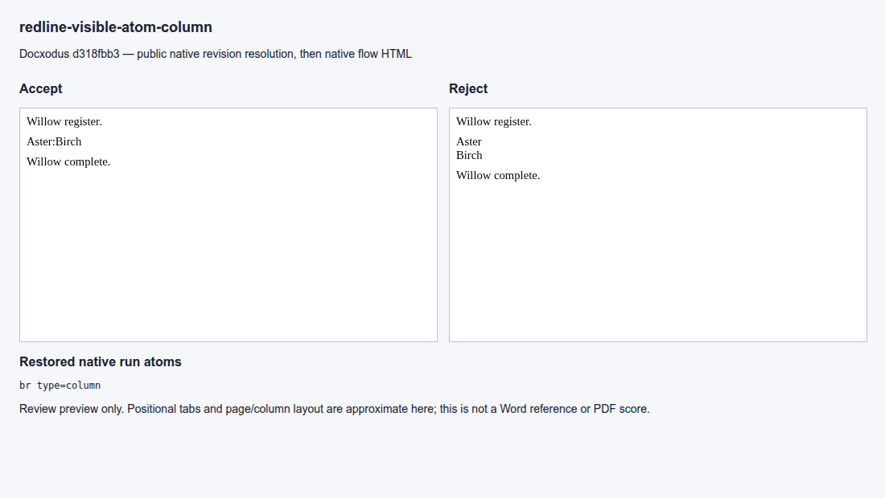

### redline-visible-atom-cr-control

### redline-visible-atom-cr

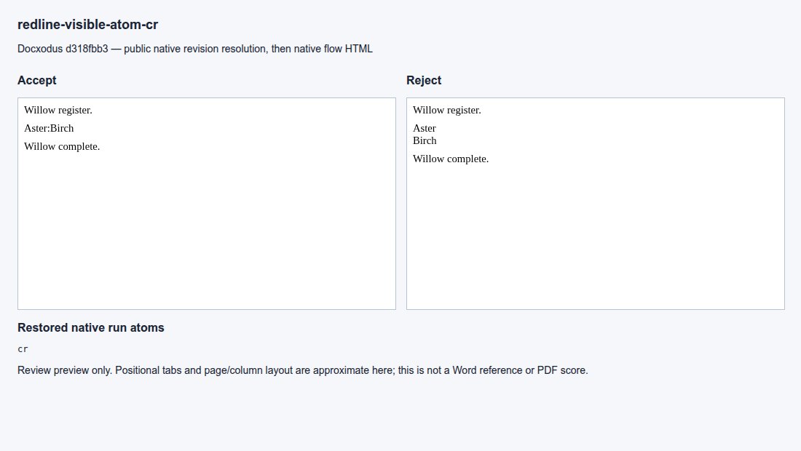

### redline-visible-atom-nonbreaking-hyphen-control

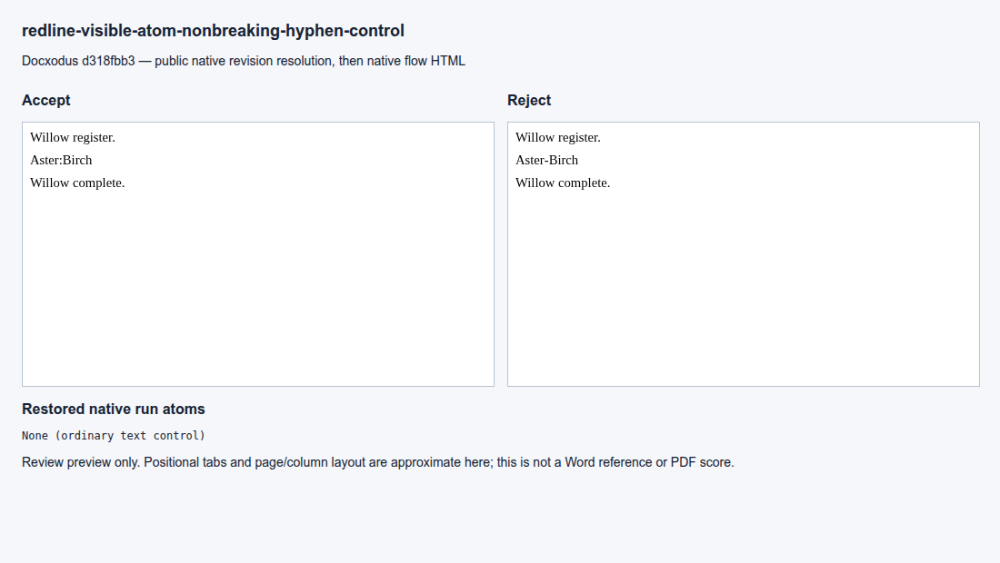

### redline-visible-atom-nonbreaking-hyphen

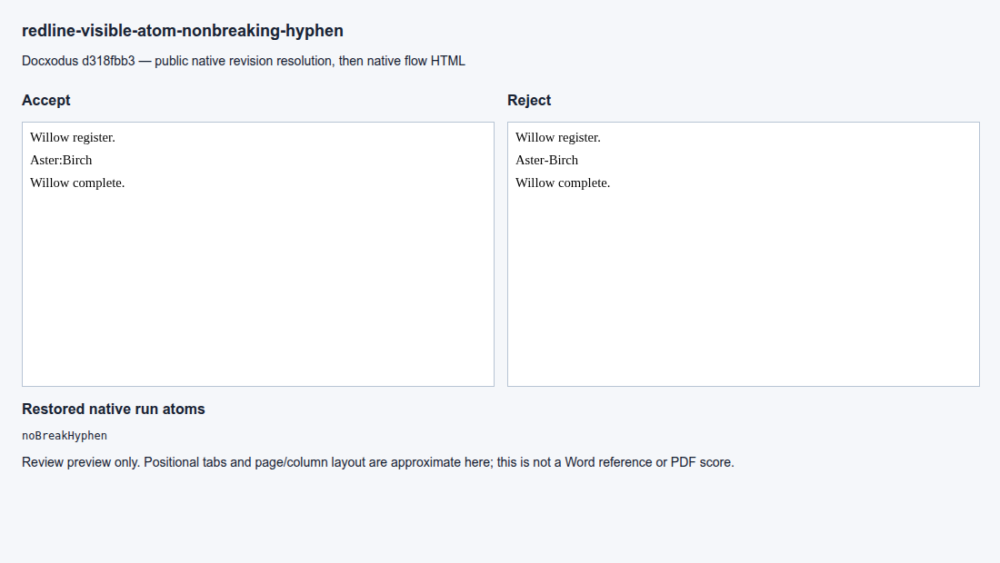

### redline-visible-atom-page-control

### redline-visible-atom-page

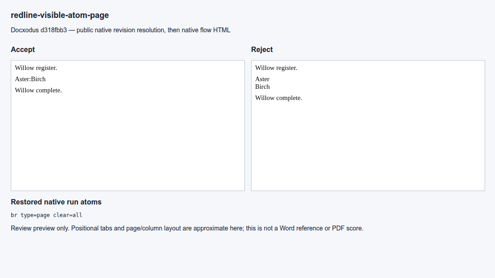

### redline-visible-atom-ptab-control

### redline-visible-atom-ptab

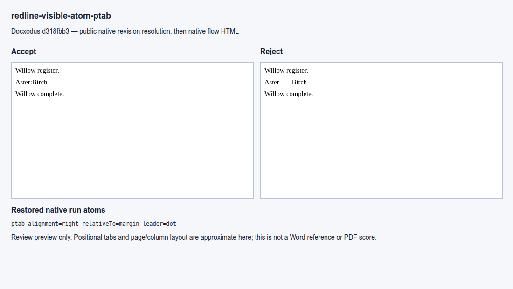

### redline-visible-atom-soft-hyphen-control

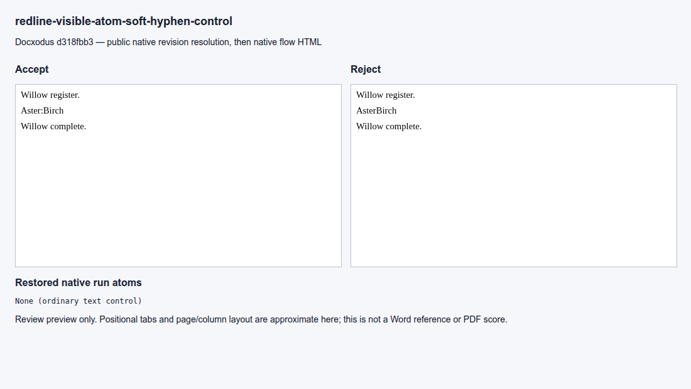

### redline-visible-atom-soft-hyphen

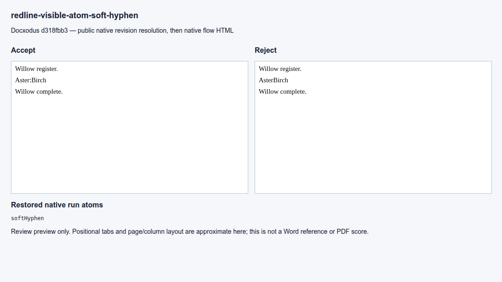

### redline-visible-atom-symbol-control

### redline-visible-atom-symbol

### redline-visible-atom-tab-control

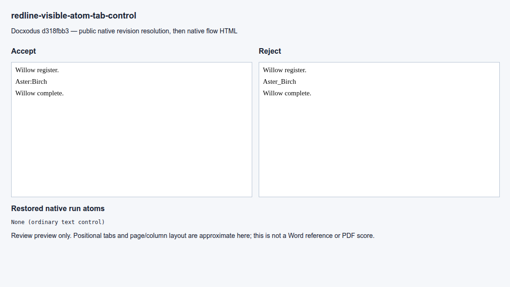

### redline-visible-atom-tab

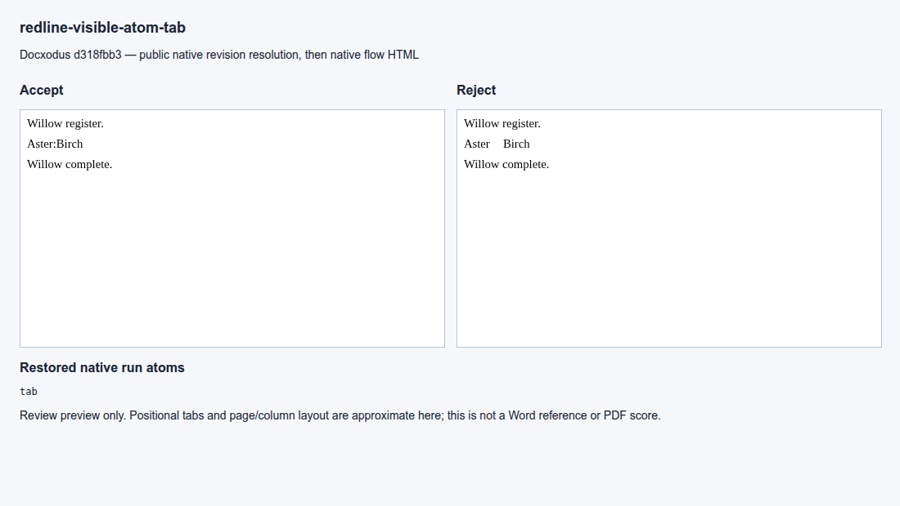

### redline-visible-inline-xml-control

### redline-visible-inline-xml

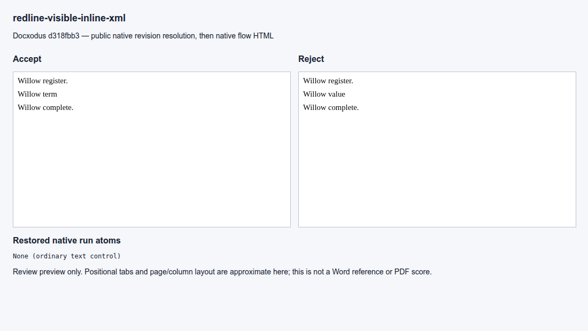
