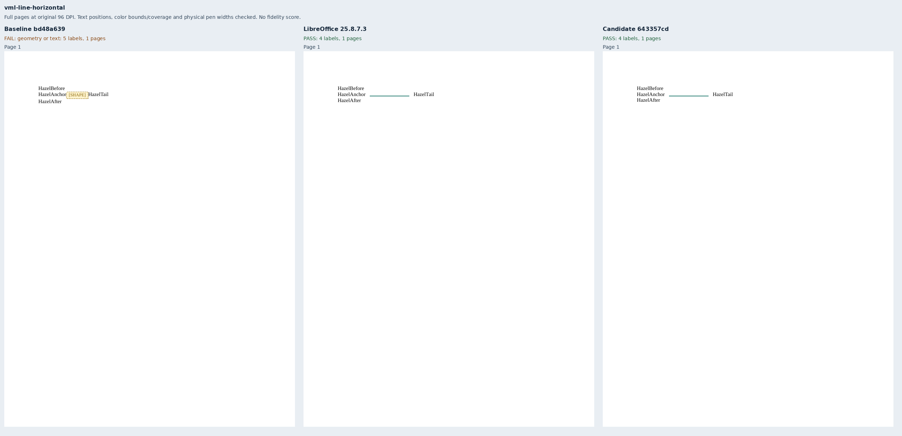
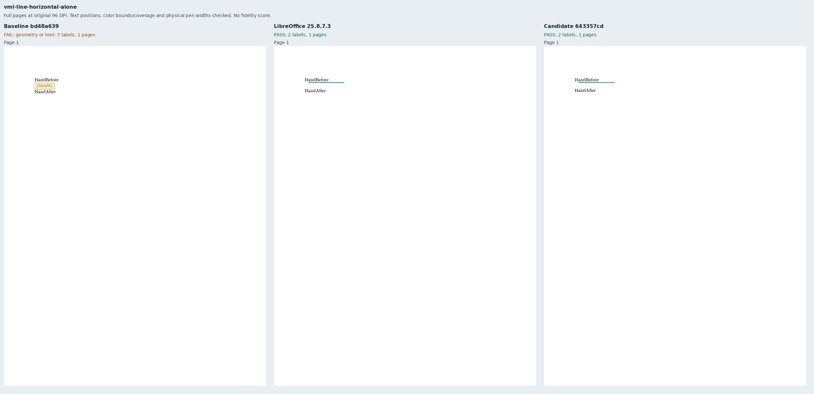
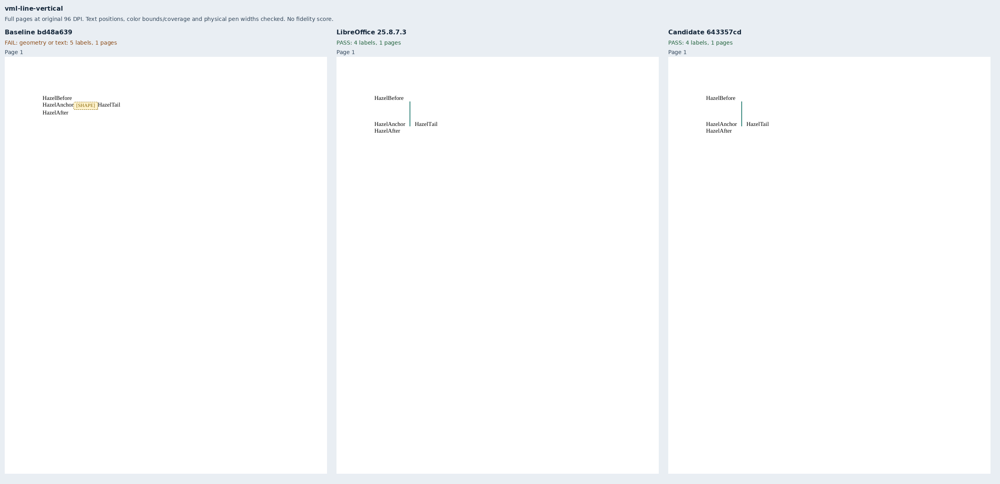
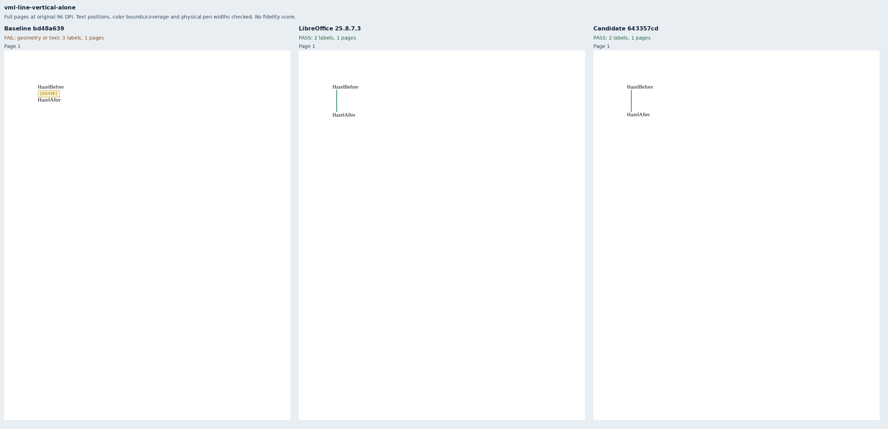
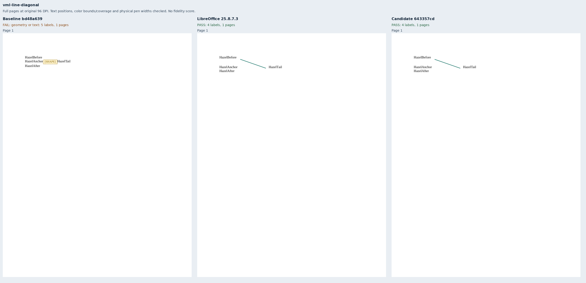
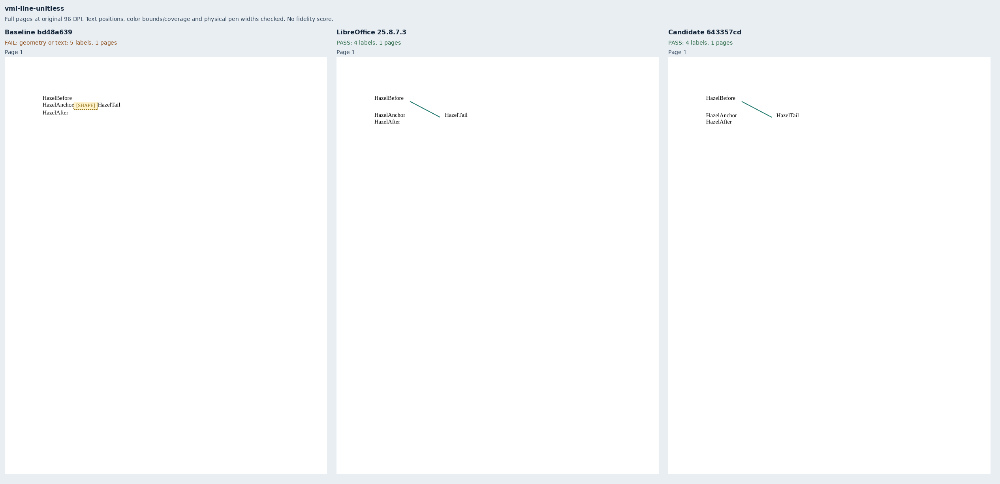
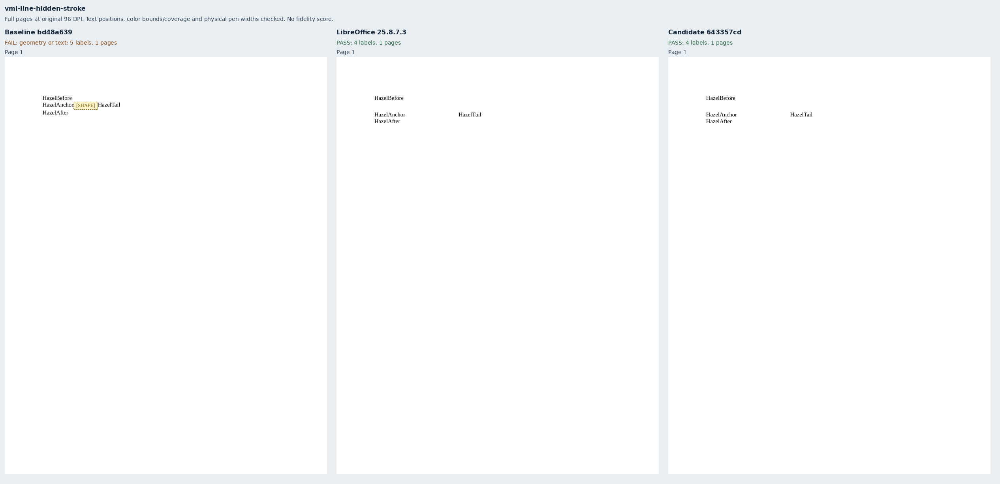
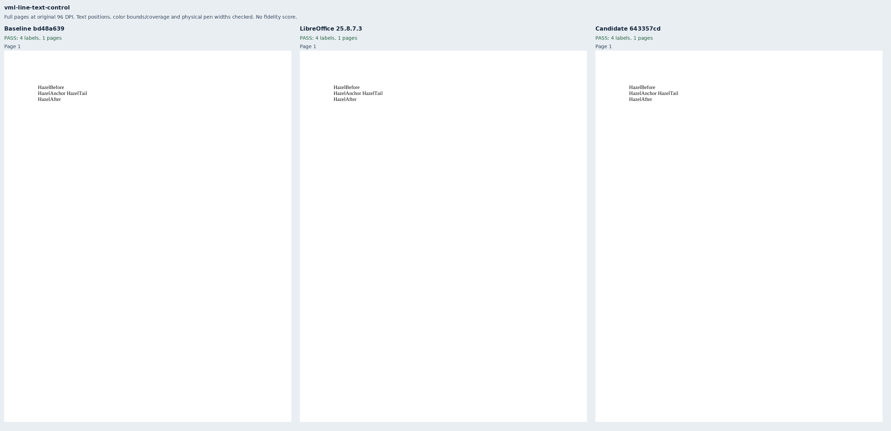

# Plain inline VML lines

Nine original Hazel packages cover horizontal and vertical lines beside text and alone,
a diagonal, a translated endpoint origin, unitless pixel coordinates, a hidden stroke,
and an unchanged text control. The labels, 83×29pt and 47pt spans, 76×40 pixel endpoint,
1.5pt teal pen and literal VML are independently authored in `bench/fixtures.py`.
All use 11pt Liberation Serif, Letter paper, 72pt margins and single line spacing.
No renderer fixture or helper is imported.

Baseline `bd48a63923accd6f2ac582ce65c2f7e5e3613c29` has the same complete source tree as main
`e4aa4544a11c3c02521b49634206ff40ac8d91a2`. It passes the text control and fails the eight line
cases. Candidate `643357cda97027b16260b3ba20ff85ef59eb7406` passes all nine through the production
public export API. This addresses only plain inline VML lines in
[Docxodus #1554](https://github.com/JSv4/Docxodus/issues/1554); the issue remains open for other
unsupported content.

LibreOffice 25.8.7.3 supplies nine eligible native references. Captures use strict font
verification and sandboxed system Chromium. These are focused, unscored diagnostics, not
pinned-runtime or full-suite fidelity results. No Word reference is claimed. Nonzero-origin
normalization and sole-line top alignment are native LibreOffice observations. Reversed
lines and omitted pen widths are deliberately outside this native corpus: LibreOffice
omits reversed paint and uses a hairline for the omitted pen, whereas the core follows
source endpoint direction and Office's 0.75pt default. The core tests separately cover
those rules, omitted endpoints, physical units and unsupported-context refusals.

Existing assertions compare all label positions within 1.5pt, teal bounds/coverage within
1.5pt/8%, and physical vector pen widths within 0.01pt. These contracts are unchanged.
They check paint extent and coverage, not every possible path topology. Contract mutations
prove that removed paint, a substituted 0.75pt pen, and a 3pt following-text shift are rejected.
For the hidden-stroke and text controls, the composer additionally verifies absent teal paint;
that supplementary check is separate from registered assertions and scores.

All nine inputs pass Open XML SDK 3.5.1 validation against Microsoft 365. Nine full-page
comparison sheets show all 27 pages at original 96 DPI. `evidence.json` binds 104 extracted
labels (including eight baseline placeholders), input/PDF/report hashes, native references,
exact clean source revisions, 19 build files and 45 runtime assets per renderer. The composer
checks complete reports, input/PDF bindings, strict verified fonts, observed browser identity,
actual asset hashes/lengths and every page's text inventory and paper bounds.

The suite advances to `core-v114` (819 inputs). All previous 810 input bytes and declarations
remain unchanged apart from generator provenance.

```sh
python3 -m bench reference libreoffice --manifest MANIFEST --out REFERENCE
node docs/results/export-reliability/Capture.mjs SOURCE MANIFEST OUTPUT ENVIRONMENT
python3 docs/results/vml-lines/Compose.py RUN BASELINE_SOURCE CANDIDATE_SOURCE
```

















