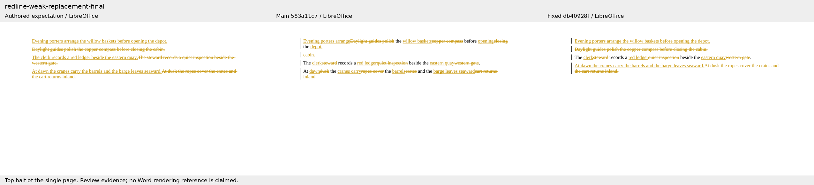
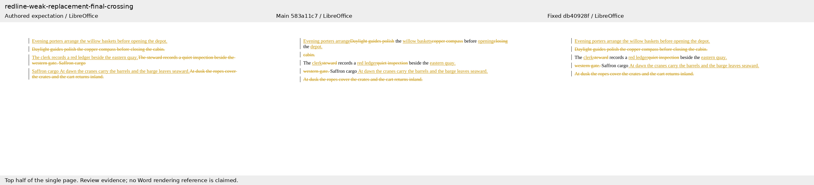
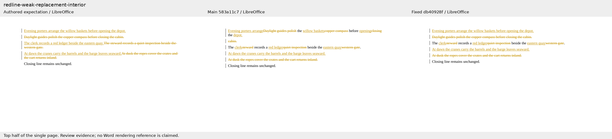
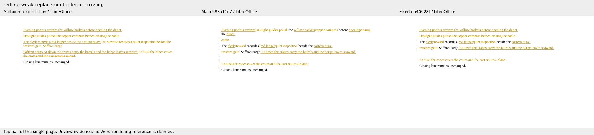
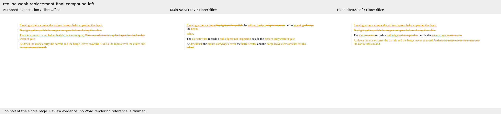
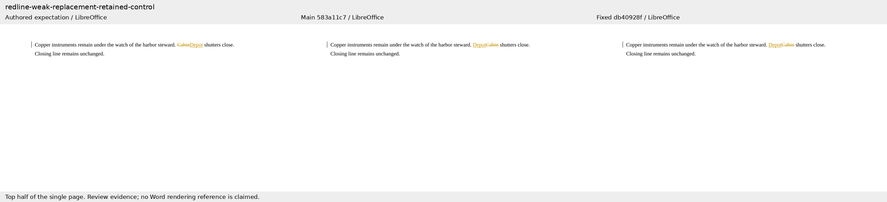
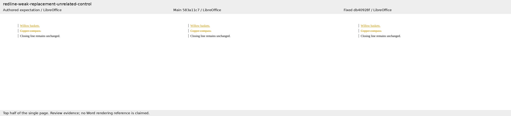
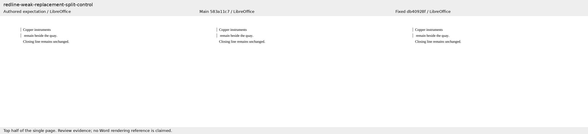

# Coherent paragraph replacement review

The six reproductions put a leading paragraph replacement beside a genuine edited paragraph.
The leading paragraphs share only function words. Variants add an unchanged closing paragraph,
a later real paragraph crossing, and a compound endpoint on either side. Four controls cover a
strong retained sentence, unrelated replacement, and intentional paragraph splits and merges.

On Docxodus `583a11c7f26fd2f4c6843c7d33198febd9127da4`, the six reproductions fail the contiguous
deleted-text assertion and the four controls pass. On `db40928ff104968d49ba078059a3811a1bcb0ba0`,
all ten cases pass. All 20 LibreOffice accept/reject comparisons apply; independent semantic
round trips and Open XML SDK 3.5.1 validation also pass. These are focused diagnostics, not a
complete 226-case suite score. `evidence.json` records every check.

Each sheet shows the authored expectation, unchanged main, and fixed result, rendered by
LibreOffice. Only the top half of each one-page document is shown; it contains all text.
The authored redline calibrates reversibility and the declared assertions, not an exact
rendering arrangement. No Microsoft Word comparison result is claimed.

### redline-weak-replacement-final

### redline-weak-replacement-final-crossing

### redline-weak-replacement-interior

### redline-weak-replacement-interior-crossing

### redline-weak-replacement-final-compound-left

### redline-weak-replacement-final-compound-right

### redline-weak-replacement-retained-control

### redline-weak-replacement-unrelated-control

### redline-weak-replacement-split-control

### redline-weak-replacement-merge-control

