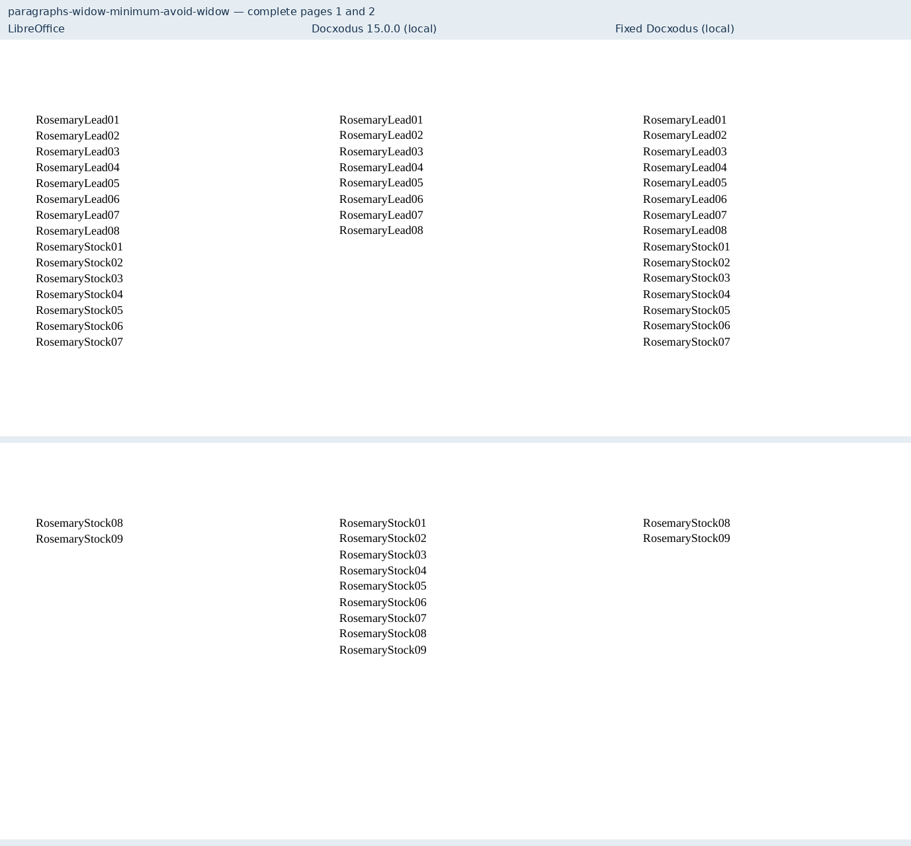
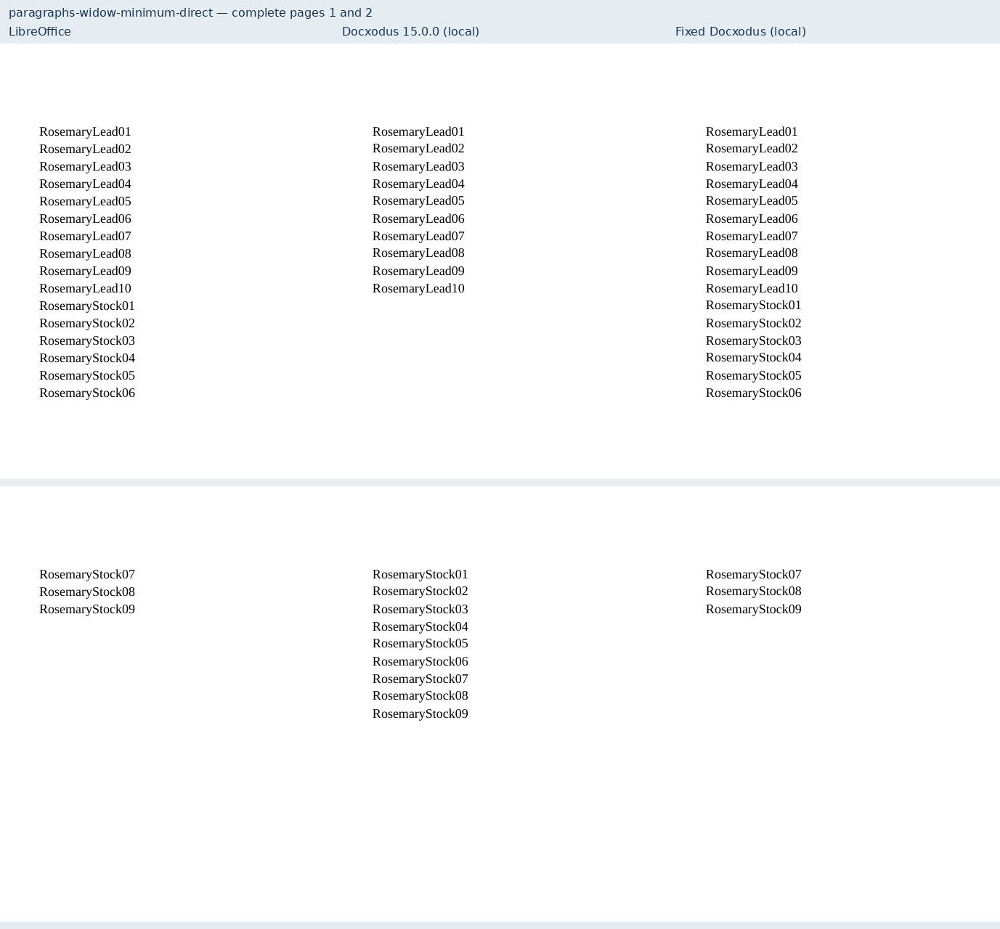
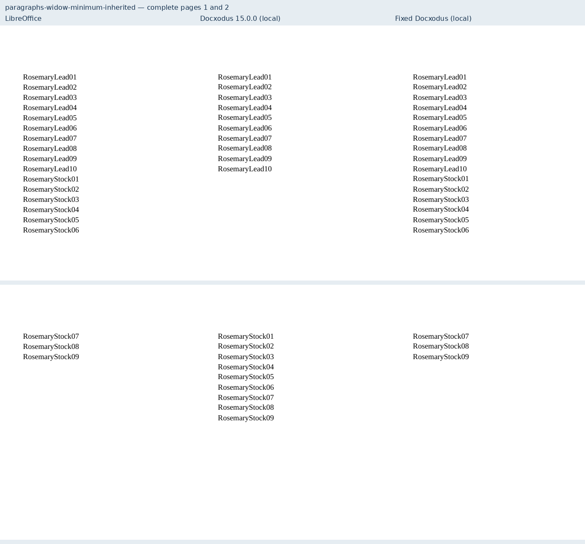
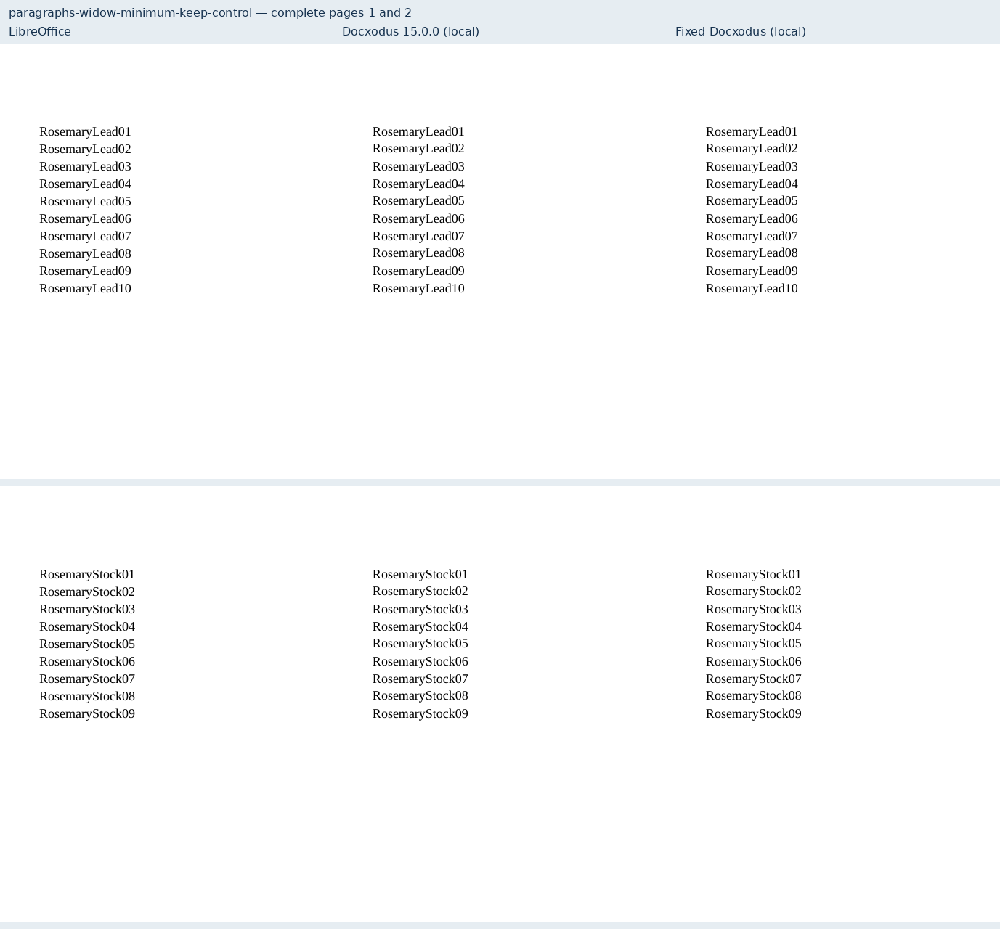
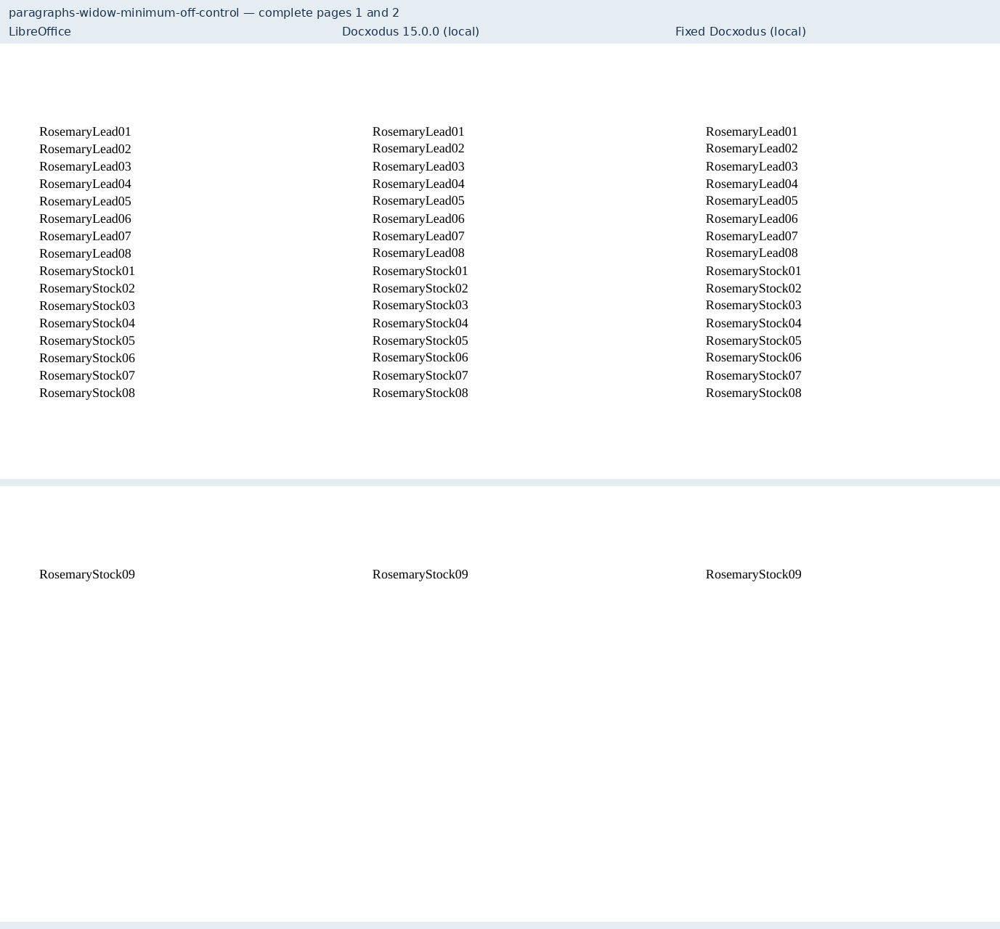
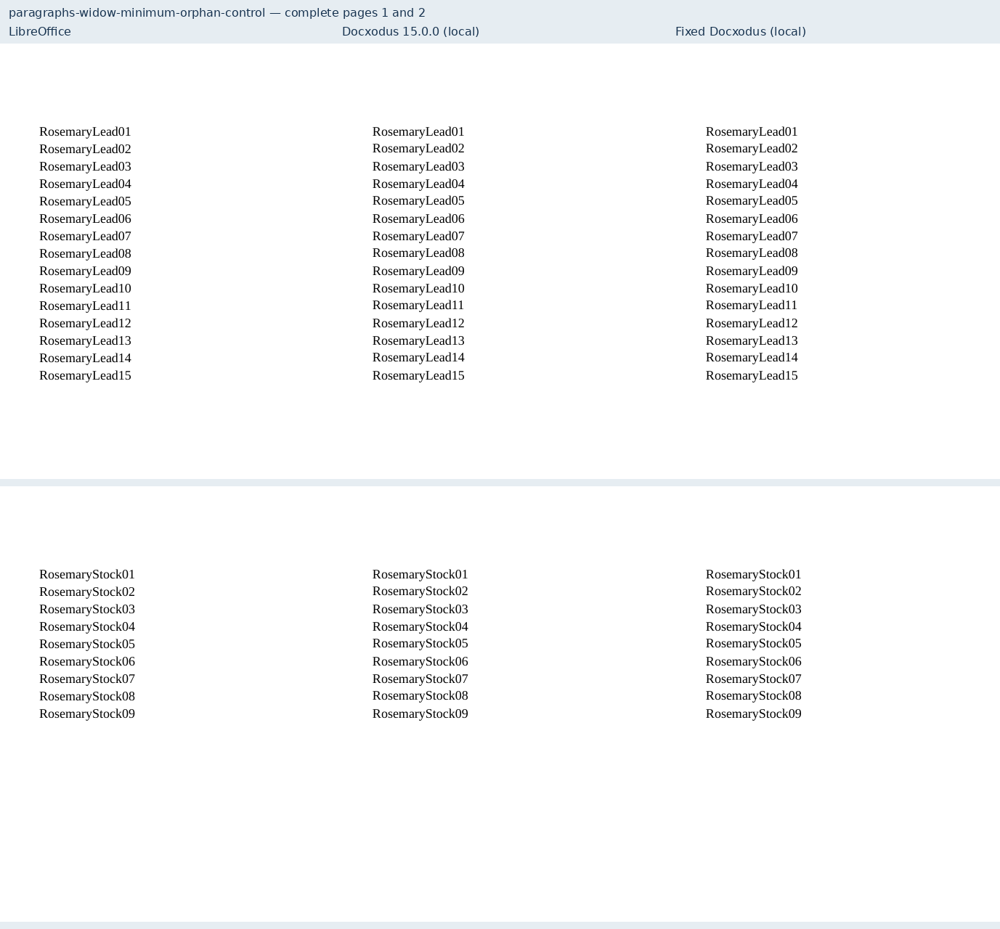

# Widow control as a line minimum

Six original fixtures cover direct and inherited widow control, a near-bottom two-line
minimum, and explicit off/keep/orphan controls for JSv4/Docxodus#1520. The text band is
256pt, each line is exactly 16pt, and every source label is inventoried and checked.

| Case | LibreOffice / fixed target lines by page | Previous Docxodus |
| --- | --- | --- |
| direct, inherited | 6 + 3 | 0 + 9 |
| avoid-widow | 7 + 2 | 0 + 9 |
| off-control | 8 + 1 | 8 + 1 |
| keep-control, orphan-control | 0 + 9 | 0 + 9 |

The screenshots show both complete pages from LibreOffice, an existing local 15.0.0
build (`4bb8386be06ded02dd41564fcf2d18742dd04cbe`), and a fresh local candidate build.
The earlier build's relevant paginator matches the issue's main baseline. These are
local diagnostics, not a full-suite calibrated score or native Word captures.
`evidence.json` binds candidate commit `39c1ae01d4d6bd970ec76adeb53af79e0d7dce76`,
paginator/converter source, runtime asset manifest, input/PDF and screenshot hashes,
marker positions and all declared checks;
`schema.json` records zero Open XML SDK 3.5.1 findings on all six inputs.

The PDF suite advances from core-v97 (701 cases) to core-v98 (707 cases). All 701 prior
input documents remain byte-identical. No metric, tolerance or historical CI suite
selection changes. Repository audit and contract tests check regeneration, provenance
and the unchanged scoring rules. Production runs pinned to the PR commits are recorded
in the PR before merge.

