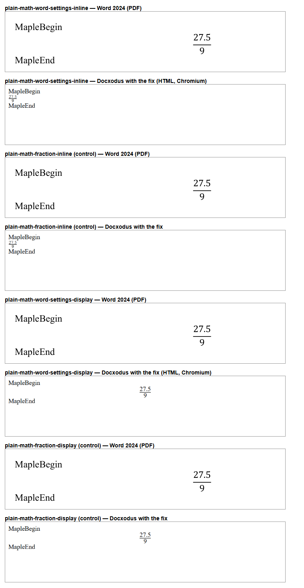

# Word's default math settings (Docxodus #1710)

`plain-math-word-settings-inline` and `plain-math-word-settings-display` are the plain Maple fraction in a
document whose `word/settings.xml` holds the math settings block Word 2024 writes into every document it
saves, each setting at the value it has when absent. Their controls are the existing
`plain-math-fraction-inline` and `plain-math-fraction-display`, which differ only by that block.

`cases.png` shows, for each case and control, Word 2024's (16.0.20326) PDF of the input and the HTML that
Docxodus writes with the fix for #1710, rendered in Chromium. Word draws each case exactly as its control.
Before the fix Docxodus draws the controls and replaces the equation of both new cases with a `[MATH]`
placeholder, which fails the cases' `math-expression` HTML assertion and their PDF token inventory.

Word was run on a machine without DejaVu Serif, so its captures show a substituted face; they illustrate
layout and are not registered references. Word also sets an equation that is alone in its paragraph as
display math, which is why the inline and display captures look alike in Word; that is unrelated to the
settings block and is the same for the controls.

LibreOffice references, authored calibration and full-suite scoring for the two cases are pending.
