# Separate Word reference evidence

This supports [Docxodus #1124](https://github.com/JSv4/Docxodus/issues/1124) and [PR #1376](https://github.com/JSv4/Docxodus/pull/1376). Word and LibreOffice are separate reference providers. There is currently one renderer layout mode, recorded as `default`. This harness change adds no public layout option and changes no scorer, tolerance, authored fixture, or historical LibreOffice reference.

The [Word reference pack](https://github.com/JSv4/docx-fidelity-bench/releases/download/word-text-precision-v1/word-text-precision-v1.zip) contains eight source/PDF pairs, font-program bindings and license notices. SHA-256: `d8d9b16397efb989900c65483bb202fd1fd3961570e83898059b27fc7f8b4486` (3,924,733 bytes). All eight references pass registration. Word's internal font aliases are qualified by exact reviewed program bindings; the glyph audit remains an operator attestation. Global gasp and full raster identity are not asserted.

The table below records the source-bound eight-case Word comparison with metric v3. Main is `9b03f6c45e6974ffa2111df4567637f79a62423b` (identical source tree to merged `0ef03ea3a4f8697633f17adc9fa42686c60b45b4`); candidate is `7954e593614574a094bd0c0104c332d24377f444`. All eight cases pass mandatory checks and score at least 95. All five page metrics hold or improve. The eight-case Word score changes from 90.81812 to 96.37008; this is not a full-corpus score. [Measurements](measurement.json) retain every page metric.

| Original case | Main against Word | Candidate against Word |
| --- | ---: | ---: |
| paragraph-contract | 84.13657 | 95.68475 |
| columns-continuous | 88.69283 | 95.41453 |
| columns-balanced | 88.82131 | 95.03262 |
| columns-break | 89.46166 | 95.10126 |
| paragraph-keep | 87.58558 | 96.33701 |
| paragraph-heading | 99.62340 | 99.62892 |
| images-square | 92.85629 | 96.69403 |
| images-tight | 93.17152 | 96.72707 |

For all eight cases and both renderer revisions, the output from the embedded-font/schema-order capture input has exactly the same unretouched 96 DPI PPM bytes as the original immutable CI input. This supports applying the Word evidence to those original cases. Input semantics are independently checked through equal document/style property trees. This evidence does not establish interchangeable input packages for arbitrary future renderer changes: CI must repeat that raster equivalence check. The original LibreOffice result and all its declines remain separate, visible evidence.

[Machine-readable evidence](evidence.json) records input, PDF and PNG hashes. [Original CI raster equivalence](original-ci-raster-equivalence.json) records every protected page hash. All 33 provider pages in these 11 panels were visually inspected. Each panel is a full physical page at the same scale, with labels outside the page: Word on the left, main in the middle, candidate on the right.

## paragraph-contract

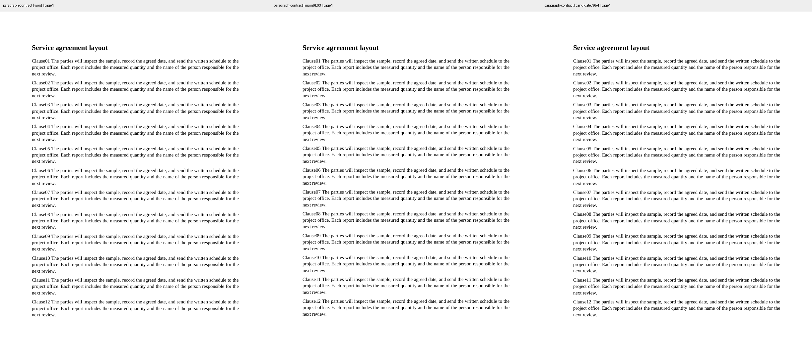

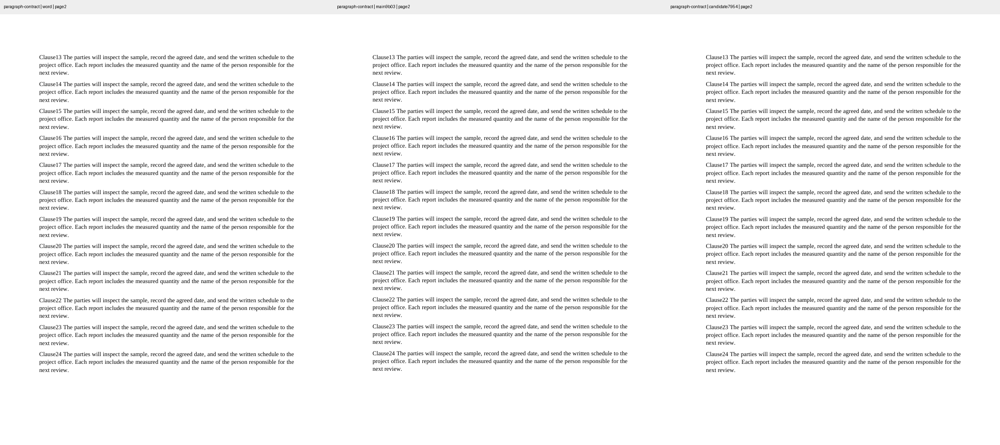

## columns-continuous

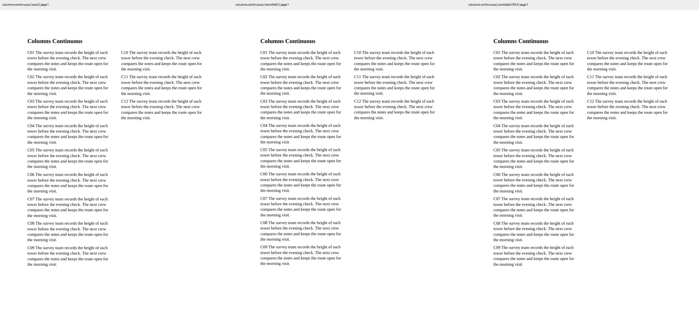

## columns-balanced

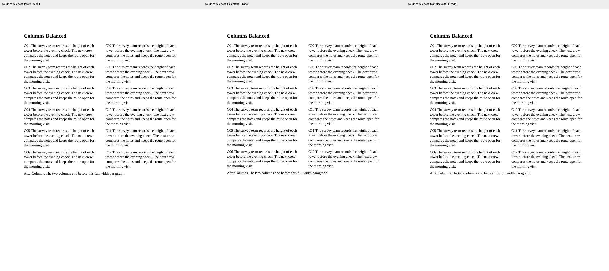

## columns-break

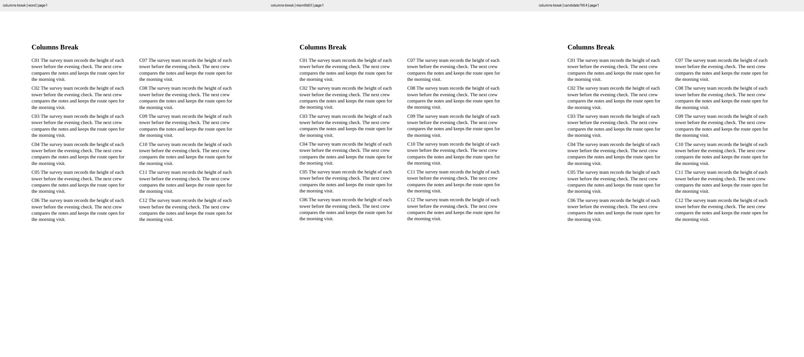

## paragraph-keep

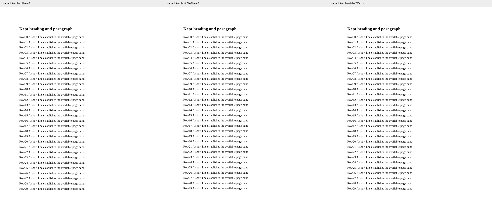

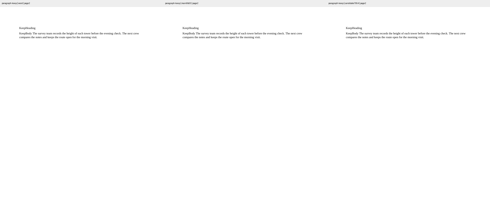

## paragraph-heading

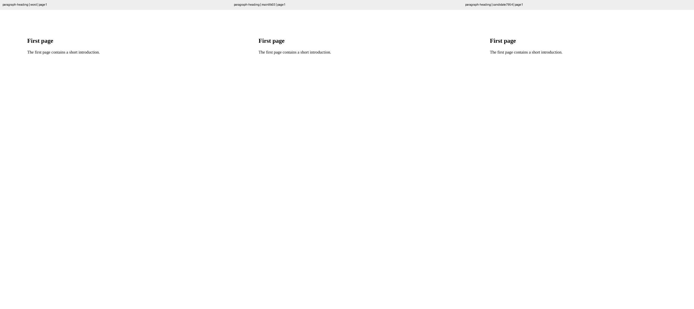

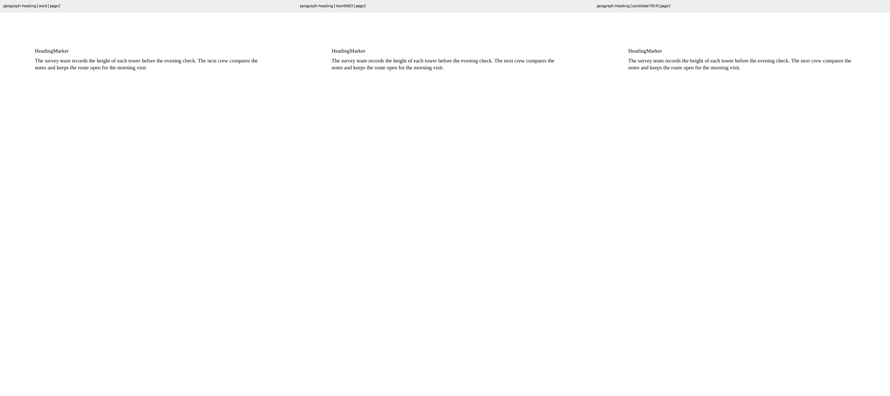

## images-square

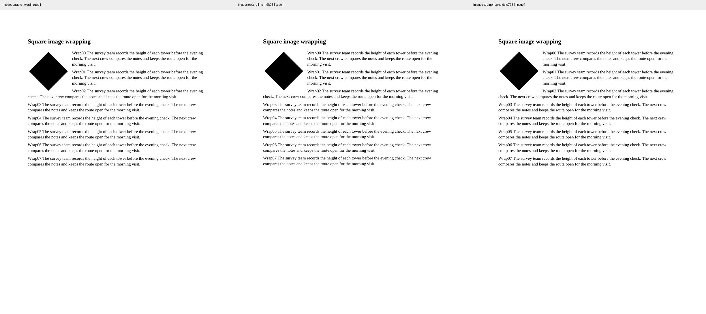

## images-tight

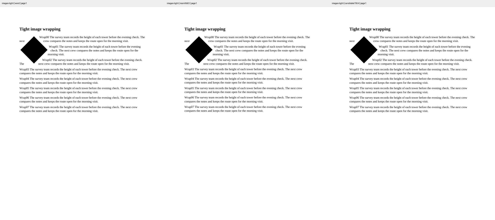
