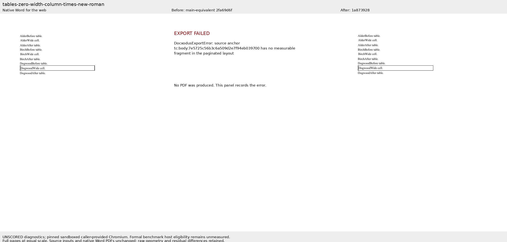
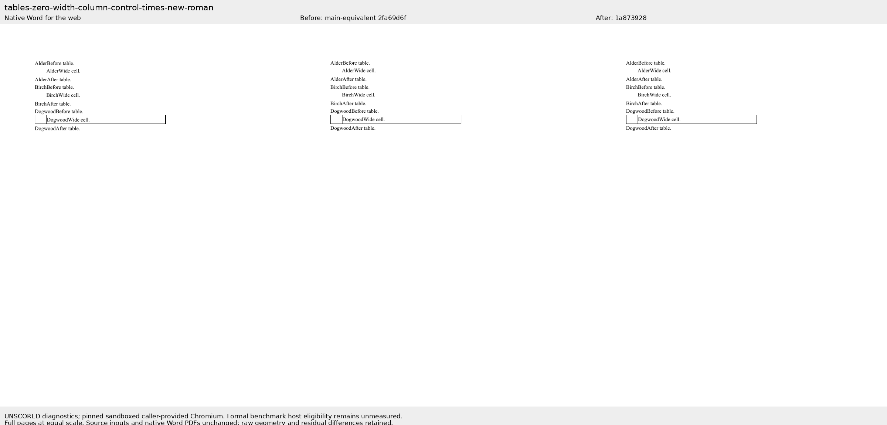

# Zero-width columns retain a measurable cell

Companion to [Docxodus #1368](https://github.com/JSv4/Docxodus/pull/1368), fixing #1201. The two new cases reuse the original author's literal OOXML from `7851026`; their bytes exactly match the retained native Word inputs. Both cover borderless and bordered tables with exact and at-least 18pt rows. The PDF suite is `core-v64` (306 cases), and `redline-v17` (152 cases) is unchanged. All 990 prior DOCX files are byte-identical.

Both Times New Roman native references pass the importer's full source, token, font and assertion checks. Source/PDF hashes, actual capture timestamps, local font-file hashes and rights are in [word-capture.json](word-capture.json). Native PDFs and UI proof remain in the durable per-issue Word pack. No reference PDF or input was repaired or rewritten.

## Results and limits

The source-bound current-main equivalent `2fa69d6f` fails export on the zero-column case with a missing cell fragment. The reviewed fix `1a873928` exports it with all required words, fonts and page geometry. Borderless wide-cell positions are within 0.03pt horizontally of Word. The bordered `DogwoodWide` marker retains a 0.529pt horizontal difference against the unchanged 0.5pt tolerance; this check remains failed in the raw evidence. Default-margin and border placement are part of the remaining horizontal-layout investigation in Docxodus #1219. The 24pt control's full extracted words and coordinates are identical before and after.

Formal candidate runs are **unmeasured**: this host lacks the required unprivileged user namespaces. Separate diagnostics use caller-provided, pinned Chromium 143.0.7499.4 with process sandboxing enabled through the already installed root-owned helper. The ordinary font files match the recorded hashes. These diagnostics do not meet the benchmark's release-baseline environment contract. No suite or fidelity score is claimed; no tolerance, font rule, gate or eligibility check changed. Cloud and local font binaries are not asserted identical.

992 affected core tests, 28 sandboxed production-export/PageMap tests, 264 benchmark Python tests and four Node adapter tests pass. All nine core Word-source packages and both benchmark packages have zero Microsoft365 SDK findings. The main-branch reproduction fails six of nine public-export probes; the fix exports all nine. Adversarial review retained narrow-cell anchors, restricted the rule to explicit fixed zero widths, and covered spans, padding, wrapped cells, nested tables, positive preferred widths and autofit.

Both screenshots were actually opened and inspected. They show full pages at equal scale; the baseline failure panel records the actual error and clearly states that no PDF was produced. Raw coordinates, checks, artifact hashes, source identities and environment qualifications are in [evidence.json](evidence.json).

